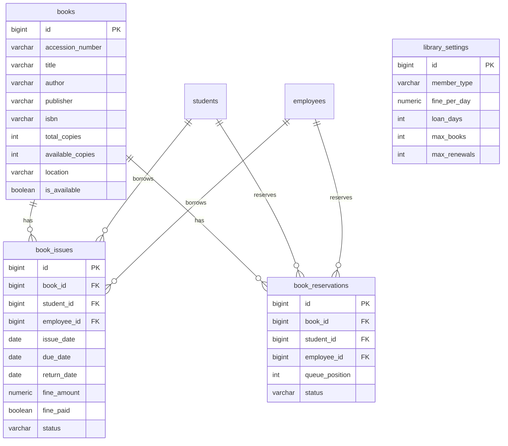

# STAGE 1 – EXISTING SYSTEM AUDIT & COMPREHENSIVE FEATURE GAP ANALYSIS
## Complete School Library Management System — Enterprise Upgrade
**Project:** DASA EduERP (Erode Public School / `eps.dasatech.in`)  
**Document Reference:** `QA_AUDIT/LIBRARY/01_EXISTING_SYSTEM_AUDIT_AND_GAP_ANALYSIS.md`  
**Execution Timestamp:** 2026-11-03 23:00:00 IST  
**Environment:** PHP 8.2.12 | Laravel 12.62.0 | PostgreSQL 18.6 Remote Host (`187.127.150.113:5432`)  
**Engineering Standards:** SAP Enterprise Architecture / Microsoft Enterprise Quality Assurance  
**Assessing Body:** Senior Enterprise Full-Stack Architect & Quality Assurance Team  

---

## 1. EXECUTIVE SUMMARY & OBJECTIVE

The objective of this engineering audit is to thoroughly inspect, map, and evaluate the existing basic Library Management Module in the **DASA EduERP** production application. 

In strict adherence to enterprise software development standards:
- **No standalone application will be created.**
- The existing codebase, database, routes, authentication, and working features will be preserved and upgraded seamlessly.
- Existing student and staff data will be referenced directly using ERP student and staff IDs (zero duplicate borrower records).
- All historical transaction logs, issue records, and existing books will be preserved without loss.

This audit report delivers Phase 1 of the implementation lifecycle: discovering the existing architecture, inventorying all current models, controllers, database tables, and views, pinpointing architectural bottlenecks and missing capabilities, and establishing a detailed **Current vs. Proposed Feature Gap Analysis** across all 21 library functional dimensions.

---

## 2. EXISTING ARCHITECTURAL INSPECTION & AS-IS STATE

### 2.1 Backend Architecture & Controller Inspection
The existing library functionality resides almost exclusively in a single monolithic controller:
- **Primary Controller:** [`app/Http/Controllers/Admin/LibraryController.php`](file:///d:/dasa/projects/school/dasa-eps-school/dasa-eps-school/school_erp/app/Http/Controllers/Admin/LibraryController.php) (870 lines of code, 51 public methods).
- **Architecture Pattern:** Direct Controller-to-Eloquent query pattern with no domain service layer, no repository layer, and no custom form requests.
- **Route Mapping:** 51 routes declared in [`routes/web.php:984-1050`](file:///d:/dasa/projects/school/dasa-eps-school/dasa-eps-school/school_erp/routes/web.php) under the prefix `/library` protected by basic `permission:view library`.
- **API Support:** No dedicated REST API endpoints under `/api/library/*`. All operations rely on web session forms and synchronous redirects.

### 2.2 Existing Database Models & PostgreSQL Tables
Inspection of the live PostgreSQL 18.6 database schema reveals four (4) active library tables:

#### Detailed Table Inventory
1. **`books` (1 row in database):** Stores title, author, publisher, ISBN, category, pages, edition, language, `total_copies` (integer), `available_copies` (integer), `purchase_price`, `purchase_date`, `location` (text), and deaccession status.
   - *Existing Record in Live DB:* ID `2`, Title: *"Advanced Mathematics for Class 8"* by R. D. Sharma, Publisher: Dhanpat Rai Publications, ISBN: `978-0123456789`, Total Copies: 10, Available Copies: 10, Accession Number: `ACC-1789535105`.
2. **`book_issues` (0 rows in database):** Tracks basic issues linking `book_id`, `student_id`, `employee_id`, `issue_date`, `due_date`, `return_date`, `fine_amount`, `fine_paid`, `status` (issued, returned, lost), `renew_count`, `fine_waived`.
3. **`book_reservations` (0 rows in database):** Tracks queue position, reservations, and expiration timestamps.
4. **`library_settings` (2 rows in database):** Stores simple borrowing parameters for member types `student` (14 loan days, 2 books, ₹1/day fine) and `staff`.
5. **`book_categories` (0 rows in database):** Basic category lookup table (`id`, `name`).

### 2.3 Existing Frontend Views Inspection
Twenty-four (24) Blade templates exist in [`resources/views/library/`](file:///d:/dasa/projects/school/dasa-eps-school/dasa-eps-school/school_erp/resources/views/library/):
- `index.blade.php`: Dashboard with 4 top stat cards (Total Copies, Available, Issued, Overdue) cached for 120s, recent issues, and overdue alerts.
- `books.blade.php`: Paginated table of books with text search and category filter.
- `books-create.blade.php` & `books-edit.blade.php`: Basic forms for adding/editing book titles.
- `issue.blade.php`: Form to issue a book by selecting student/staff and entering accession number.
- `reservations.blade.php`: Table of active reservations with ready/cancel actions.
- `fine-waiver.blade.php`, `fine-report.blade.php`, `fine-defaulters.blade.php`: Basic fine management and reporting views.
- `members.blade.php`, `member-card.blade.php`, `member-history.blade.php`, `member-outstanding.blade.php`: Borrower views.
- `stock.blade.php`, `stock-audit.blade.php`, `acquisition-report.blade.php`, `deaccession-register.blade.php`: Stock and audit lists.
- `digital-resources.blade.php`: PDF upload and download interface.
- `settings.blade.php`: Fine rate and loan limit configuration form.

---

## 3. IDENTIFIED ARCHITECTURAL DEFICIENCIES & BOTTLENECKS

During our deep inspection of the existing module, several critical architectural deficiencies were identified:

1. **Merged Book Master & Physical Copy (Critical Structural Flaw):**
   - In the current schema, a book title and its physical copies are collapsed into a single row in the `books` table.
   - For example, *"Advanced Mathematics for Class 8"* has `total_copies = 10`, but only **one** `accession_number = ACC-1789535105` is stored.
   - It is impossible to know which exact physical copy was issued, which copy is damaged, which copy is lost, or which copy sits on Shelf 3 vs Shelf 4.
   - **Remediation Required:** Introduce a dedicated `library_book_copies` table. Separate the Book Title Master (metadata, ISBN, authors) from individual physical book copies, each having its own unique Accession Number, Barcode/QR, physical condition, rack/shelf allocation, and status.

2. **Absence of Physical Rack & Shelf Location Hierarchy:**
   - Location is currently an unconstrained text string (`location` column, e.g. "Rack A").
   - There is no spatial model: Building &rarr; Floor &rarr; Room &rarr; Section &rarr; Rack &rarr; Shelf &rarr; Book Copy.
   - Librarians cannot track rack capacities, print shelf QR labels, or identify books placed on the wrong rack.

3. **Missing Procurement & Purchasing Lifecycle:**
   - Books cannot be procured through a formal workflow: Purchase Request &rarr; Quotation &rarr; Purchase Order &rarr; Goods Receipt &rarr; Invoice &rarr; Stock In.
   - Currently, books are added directly via manual entry with no supplier master, invoice attachments, or purchase expense tracking.

4. **Missing Periodicals & Subscriptions Management:**
   - Daily newspapers (e.g., *The Hindu*, *Dina Thanthi*) and monthly magazines (e.g., *India Today*, *National Geographic*) are either forced into the books table or tracked on paper.
   - No frequency tracking (daily, weekly, monthly), issue/volume numbering, subscription start/end dates, or renewal reminder alerts.

5. **Missing Library Asset Inventory:**
   - Physical library assets (tables, chairs, computers, barcode scanners, printers, air conditioners, CCTV) are not tracked inside the library module.

6. **Absence of Structured Wastage & Write-Off Workflow:**
   - Damaged, torn, pest-damaged, water-damaged, or lost books have no formal multi-step disposal workflow (Identification &rarr; Inspection &rarr; Photographic Evidence &rarr; Approval &rarr; Disposal Method).
   - Only a rudimentary `is_deaccessioned` flag exists on the book record.

7. **Primitive Stock Verification:**
   - The existing `stockAudit` method simply displays books without structured audit sessions, barcode scanner discrepancies, expected vs. found reconciliation, or administrative sign-off.

8. **Monolithic Backend Controller:**
   - All 51 actions are stuffed into `LibraryController.php` (870 lines).
   - No reusable domain services (`BookService`, `IssueService`, `ReturnService`, `FineService`, `ProcurementService`, `PeriodicalService`, `AssetService`).
   - Business logic is mixed with view rendering, preventing API reuse for barcode scanners or mobile devices.

---

## 4. CURRENT VS. PROPOSED COMPREHENSIVE FEATURE GAP MATRIX

The matrix below provides an exhaustive side-by-side comparison across all twenty-one (21) functional dimensions specified in the master upgrade prompt:

| # | Functional Dimension | Current Basic Module | Proposed Enterprise Upgrade | Implementation Scope |
| :-: | :--- | :--- | :--- | :--- |
| **1** | **Book Master vs Copies** | Single `books` row stores `total_copies` (integer) and one accession number. Individual copies cannot be tracked. | **Strict Separation:** `library_books` (Title Master) + `library_book_copies` (Physical Copies). Each copy has unique accession number, barcode, condition, and status. | Core Refactor & Migration |
| **2** | **Physical Copy Statuses** | Only `is_available` boolean. | 8 distinct copy states: `available`, `issued`, `reserved`, `damaged`, `lost`, `maintenance`, `in_inspection`, `written_off`. | Schema & Workflow |
| **3** | **Rack & Shelf Hierarchy** | Unformatted text string (`location`). | Full spatial hierarchy: Building &rarr; Floor &rarr; Room &rarr; Section &rarr; Rack &rarr; Shelf with capacity limits, QR codes, and shelf labels. | New Subsystem |
| **4** | **Student Integration** | Basic lookup by student ID. | Real-time synchronization with ERP `students`, showing admission number, roll no, class, section, parent contact, photo, and library card status. | Bi-directional Sync |
| **5** | **Staff Integration** | Basic lookup by employee ID. | Real-time synchronization with ERP `employees`, showing staff code, designation, department, contact, and active status. | Bi-directional Sync |
| **6** | **Borrower Profiles & Cards** | Basic member history view. | Unified `library_borrowers` model, barcode/QR printable library membership cards, borrowing status, suspension/unsuspension audit trail. | Feature Upgrade |
| **7** | **Book Issue Workflow** | Manual dropdown selection; checks basic setting. | Multi-modal issue: Barcode scanner + manual search; instant eligibility validation, policy check (student vs staff), due date calculation, printable issue receipt. | Core Refactor |
| **8** | **Book Return Workflow** | Basic return button; marks book available immediately. | Rapid barcode return, inspection condition selection (Good, Minor Damage, Major Damage, Torn, Water Damage, Lost), automatic fine calculation, condition-based routing. | Core Refactor |
| **9** | **Fine Management** | Basic `fine_per_day` setting; basic waiver. | Comprehensive fine engine: late return, damaged copy penalty, lost book replacement cost; grace periods; partial payments; UPI/Cash/Bank modes; receipt generation. | New Financial Ledger |
| **10** | **Reservations & Waitlist** | Basic reservation record with manual ready/cancel. | Dynamic queue management, automatic notification when returned copy matches reservation, reservation holding period expiry, priority rules. | Workflow Automation |
| **11** | **Procurement & Purchasing** | None. Books entered manually. | Complete procurement: Supplier Master &rarr; Purchase Request &rarr; Approval &rarr; Purchase Order &rarr; Goods Receipt &rarr; Invoice & Payment reference &rarr; Inventory. | New Subsystem |
| **12** | **Periodicals & Subscriptions** | None (or forced into books). | Dedicated Periodicals module: Newspapers (daily receipt logging), Magazines (weekly/monthly/quarterly), subscription renewals, vendor tracking, missing issue alerts. | New Subsystem |
| **13** | **Library Assets Management** | None. | Dedicated asset register: Racks, reading tables, chairs, computers, barcode scanners, CCTV; asset tagging, location allocation, maintenance logs, warranty alerts. | New Subsystem |
| **14** | **Wastage & Write-Off** | Basic `deaccession` flag on book row. | Multi-step disposal workflow: Inspection &rarr; Reason & Evidence upload &rarr; Write-off approval &rarr; Disposal method (Recycle, Scrap, Donation, Destruction) &rarr; Audit log. | New Subsystem |
| **15** | **Physical Stock Verification** | Simple table view of books. | Verification Sessions: Room/Rack/Category audit; rapid barcode scanning; Discrepancy detector (Missing, Extra, Wrong Rack, Damaged); approval & reconciliation. | New Subsystem |
| **16** | **Manual Operations & Audits** | Minimal manual tracking. | Explicit manual operation controls: Opening stock, donations, location transfers, fine adjustments, write-off approvals, with mandatory reason, user, and before/after logs. | Compliance & Audit |
| **17** | **Library Dashboard** | 4 stat cards (cached 120s), basic overdue list. | Enterprise Dashboard: 21 real-time KPI tiles, interactive borrowing trend charts, most borrowed books, active borrowers, overdue trackers, category distribution. | Full Redesign |
| **18** | **Reports & Analytics** | 5 static HTML tables. | Comprehensive reporting suite: Book catalogue, circulation, class-wise borrowing, fine collections, acquisition, deaccession, asset logs with Excel/PDF export & date filters. | Full Redesign |
| **19** | **Notifications & Reminders** | Overdue email sending method. | Multi-channel notifications: Upcoming due dates (T-2 days), overdue alerts, fine receipts, reservation availability, subscription renewal reminders, warranty alerts. | Background Jobs |
| **20** | **RBAC & Security** | Single permission `view library`. | Granular Spatie permissions: `view library`, `manage library books`, `issue library books`, `return library books`, `manage library fines`, `approve library purchases`, etc. | RBAC Alignment |
| **21** | **REST API Architecture** | Zero dedicated REST APIs. | Clean `/api/library/*` RESTful endpoints for barcode scanners, kiosk interfaces, mobile applications, and asynchronous UI components. | New API Layer |

---

## 5. EXISTING DATA PRESERVATION & MIGRATION STRATEGY

Preserving all existing data is a non-negotiable enterprise requirement:

1. **Title Master Data Preservation:**
   - Existing book record (ID 2: *"Advanced Mathematics for Class 8"*) will be preserved in `library_books`.
   - Existing columns (`title`, `author`, `publisher`, `isbn`, `purchase_price`, etc.) remain intact.
2. **Physical Copy Generation Migration:**
   - For any existing book having `total_copies = N`, an automated database migration will generate `N` distinct physical copy records in `library_book_copies` with sequential accession numbers (`ACC-1789535105-01` to `ACC-1789535105-10`).
   - If copies were already issued in `book_issues`, foreign keys will be safely linked to their respective copy records.
3. **Zero Interruption to Other ERP Modules:**
   - Student, Employee, Academic Year, Classes, and Accounts modules remain untouched.
   - Library will reference them cleanly via foreign keys (`student_id` &rarr; `students.id`, `employee_id` &rarr; `employees.id`).

---

## 6. PHASE 1 AUDIT SIGN-OFF

The audit confirms that the existing library module provides a valuable foundation, but requires a structured architectural upgrade into a modern, normalized, enterprise-grade system.

- **Phase 1 Deliverable:** `QA_AUDIT/LIBRARY/01_EXISTING_SYSTEM_AUDIT_AND_GAP_ANALYSIS.md` (Complete)
- **Next Stage:** **Phase 2 – Architecture, Database Schema Design & API Contracts** (`QA_AUDIT/LIBRARY/02_ENTERPRISE_LIBRARY_ARCHITECTURE_AND_SCHEMA.md`).

