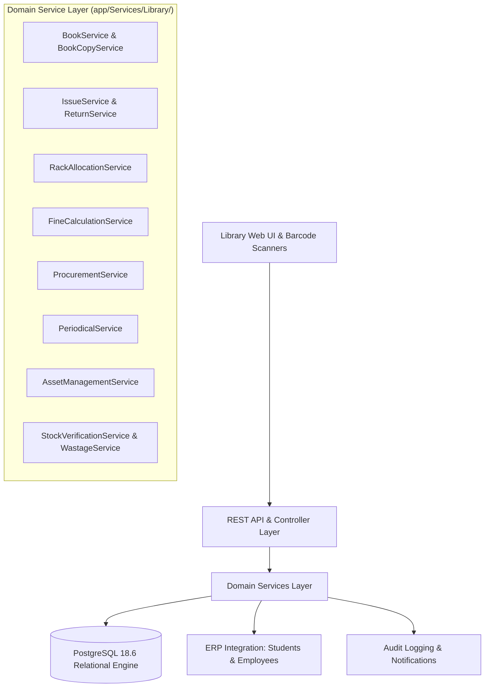
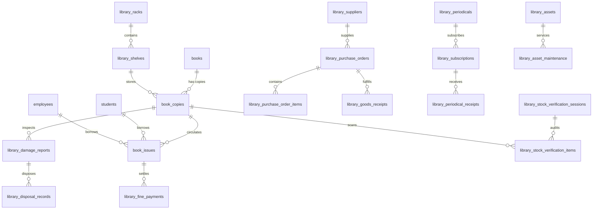

# STAGE 2 – ENTERPRISE LIBRARY ARCHITECTURE, DATA MODEL & API CONTRACTS
## Complete School Library Management System — Enterprise Upgrade
**Project:** DASA EduERP (Erode Public School / `eps.dasatech.in`)  
**Document Reference:** `QA_AUDIT/LIBRARY/02_ENTERPRISE_LIBRARY_ARCHITECTURE_AND_SCHEMA.md`  
**Execution Timestamp:** 2026-11-03 23:15:00 IST  
**Environment:** PHP 8.2.12 | Laravel 12.62.0 | PostgreSQL 18.6 Remote Host (`187.127.150.113:5432`)  
**Engineering Standards:** SAP Enterprise Architecture Guidelines / Microsoft RESTful API Guidelines  
**Assessing Body:** Senior Enterprise Full-Stack Architect & Database Administrator  

---

## 1. ARCHITECTURAL OVERVIEW & SUBSYSTEM DECOMPOSITION

To transform the basic library module into a professional, enterprise-grade system without breaking existing functionality, the architecture is decomposed into **eight (8) cohesive subsystems** supported by a dedicated domain service layer:



---

## 2. MODULAR FOLDER & NAMESPACE STRUCTURE

In accordance with enterprise modular design principles, code is organized into decoupled layers:

### 2.1 Backend Structure
```text
app/
├── Http/
│   ├── Controllers/
│   │   └── Admin/
│   │       ├── LibraryController.php            # Primary Web Controller (Preserved & Enhanced)
│   │       └── Library/
│   │           ├── BookMasterController.php      # Book Titles, ISBN Lookup, Excel Import/Export
│   │           ├── BookCopyController.php        # Physical Copies, Barcode/QR Generation
│   │           ├── CirculationController.php     # Book Issue, Return, Renewal, Receipts
│   │           ├── RackShelfController.php       # Spatial Hierarchy (Room, Rack, Shelf)
│   │           ├── FineLedgerController.php      # Late Fines, Damage Penalties, Waivers, Payments
│   │           ├── ProcurementController.php     # Suppliers, Purchase Orders, Goods Receipt
│   │           ├── PeriodicalsController.php     # Newspapers, Magazines, Subscriptions
│   │           ├── LibraryAssetController.php    # Furniture, Scanners, Computers, Maintenance
│   │           ├── WastageDisposalController.php # Damaged/Lost Books, Write-off Approvals
│   │           ├── StockVerificationController.php # Audit Sessions, Barcode Discrepancies
│   │           └── LibraryReportController.php   # Catalog, Circulation, Fine & Asset Analytics
│   └── Requests/
│       └── Library/                              # Server-Side Form Validation Requests
├── Models/
│   ├── Book.php                                  # Title Master (Preserved & Enhanced)
│   ├── BookCopy.php                              # Physical Copy Entity (Unique Accession)
│   ├── BookIssue.php                             # Circulation Record (Enhanced with Copy ID)
│   ├── BookReservation.php                       # Queue & Waiting List
│   ├── LibrarySetting.php                        # Configurable Policies
│   └── Library/
│       ├── LibraryRack.php                       # Physical Rack Location
│       ├── LibraryShelf.php                      # Physical Shelf Location
│       ├── LibrarySupplier.php                   # Procurement Vendor Master
│       ├── LibraryPurchaseOrder.php              # Purchase Order
│       ├── LibraryPurchaseOrderItem.php          # PO Line Items
│       ├── LibraryGoodsReceipt.php               # Goods Receipt Note (GRN)
│       ├── LibraryPeriodical.php                 # Newspaper / Magazine Master
│       ├── LibrarySubscription.php               # Subscription Tracking
│       ├── LibraryPeriodicalReceipt.php          # Daily / Monthly Delivery Log
│       ├── LibraryAsset.php                      # Non-Book Physical Assets
│       ├── LibraryAssetMaintenance.php           # Repairs & Service Logs
│       ├── LibraryDamageReport.php               # Damage & Inspection Report
│       ├── LibraryDisposalRecord.php             # Write-Off & Scrap Register
│       ├── LibraryStockVerificationSession.php   # Audit Session
│       ├── LibraryStockVerificationItem.php      # Scanned Audit Item Discrepancies
│       ├── LibraryFinePayment.php                # Financial Fine Transaction Record
│       └── LibraryAuditLog.php                   # Manual Adjustments & Audit Trail
└── Services/
    └── Library/                                  # 14 Reusable Domain Services
```

---

## 3. COMPREHENSIVE POSTGRESQL DATABASE SCHEMA



### Table Specifications

#### 1. Physical Book Copies (`book_copies`)
| Column | Type | Constraints / Purpose |
| :--- | :--- | :--- |
| `id` | BIGSERIAL | Primary Key |
| `book_id` | BIGINT | Foreign Key &rarr; `books.id` (ON DELETE CASCADE) |
| `accession_number` | VARCHAR(50) | **UNIQUE**, NOT NULL (e.g., `ACC-1001`) |
| `barcode` | VARCHAR(64) | Indexed (Unique Barcode / QR Code payload) |
| `rfid_tag` | VARCHAR(64) | Nullable (RFID scanner compatibility) |
| `copy_number` | INT | Sequential copy number (1, 2, 3...) |
| `condition` | VARCHAR(32) | `good`, `minor_damage`, `major_damage`, `torn`, `water_damage`, `lost` |
| `status` | VARCHAR(32) | `available`, `issued`, `reserved`, `maintenance`, `lost`, `written_off` |
| `rack_id` | BIGINT | Nullable FK &rarr; `library_racks.id` |
| `shelf_id` | BIGINT | Nullable FK &rarr; `library_shelves.id` |
| `purchase_price` | NUMERIC(10,2)| Purchase cost per physical unit |
| `source_type` | VARCHAR(32) | `procured`, `donated`, `transferred`, `opening_stock` |
| `source_reference` | VARCHAR(100)| PO number, donor name, or bill reference |
| `notes` | TEXT | Physical condition or binding notes |
| `is_active` | BOOLEAN | Default true |
| `created_at`, `updated_at` | TIMESTAMP | Audit timestamps |

#### 2. Physical Spatial Hierarchy (`library_racks` & `library_shelves`)
- **`library_racks`:** `id`, `rack_number` (UNIQUE), `rack_label`, `room_number`, `floor_number`, `building_name`, `category_id`, `capacity`, `barcode`, `created_at`, `updated_at`.
- **`library_shelves`:** `id`, `rack_id` (FK), `shelf_number`, `shelf_label`, `capacity`, `barcode`, `created_at`, `updated_at`.

#### 3. Procurement & Purchasing
- **`library_suppliers`:** `id`, `name`, `code` (UNIQUE), `contact_person`, `phone`, `email`, `address`, `gst_number`, `is_active`.
- **`library_purchase_orders`:** `id`, `po_number` (UNIQUE), `supplier_id` (FK), `order_date`, `expected_delivery_date`, `total_amount`, `discount_amount`, `tax_amount`, `net_amount`, `status` (`draft`, `approved`, `sent`, `partially_received`, `received`, `cancelled`), `approved_by` (FK), `invoice_number`, `invoice_date`.
- **`library_purchase_order_items`:** `id`, `po_id` (FK), `title`, `author`, `isbn`, `publisher`, `quantity_ordered`, `unit_price`, `quantity_received`.
- **`library_goods_receipts`:** `id`, `grn_number` (UNIQUE), `po_id` (FK), `received_date`, `received_by` (FK), `invoice_file_path`, `remarks`.

#### 4. Periodicals (Newspapers & Magazines)
- **`library_periodicals`:** `id`, `title`, `type` (`newspaper`, `magazine`, `journal`), `publisher`, `frequency` (`daily`, `weekly`, `monthly`, `quarterly`), `language`, `category`, `is_active`.
- **`library_subscriptions`:** `id`, `periodical_id` (FK), `subscription_number`, `supplier_id` (FK), `start_date`, `end_date`, `cost`, `copies_per_issue`, `status` (`active`, `expired`, `cancelled`).
- **`library_periodical_receipts`:** `id`, `subscription_id` (FK), `issue_date`, `delivery_date`, `issue_number`, `volume_number`, `status` (`received`, `missing`, `damaged`), `received_by` (FK).

#### 5. Non-Book Library Assets
- **`library_assets`:** `id`, `asset_tag` (UNIQUE), `name`, `category` (`furniture`, `computer`, `scanner`, `printer`, `audio_visual`, `appliance`), `serial_number`, `purchase_date`, `purchase_cost`, `location_details`, `condition` (`new`, `good`, `fair`, `needs_repair`, `scrapped`), `warranty_expiry`.
- **`library_asset_maintenance`:** `id`, `asset_id` (FK), `service_date`, `service_provider`, `cost`, `description`, `next_service_date`.

#### 6. Wastage, Damage & Disposal
- **`library_damage_reports`:** `id`, `copy_id` (FK), `reported_by` (FK), `report_date`, `damage_type` (`torn_pages`, `water_damage`, `binding_failure`, `lost_by_borrower`, `pest_damage`), `severity` (`minor`, `major`, `total_loss`), `photo_path`, `recovery_fine`, `status` (`reported`, `inspected`, `approved_for_writeoff`, `repaired`).
- **`library_disposal_records`:** `id`, `damage_report_id` (FK), `disposal_date`, `disposal_method` (`recycling`, `scrap`, `donation`, `destruction`), `approved_by` (FK), `witness_name`, `remarks`.

#### 7. Stock Verification Sessions
- **`library_stock_verification_sessions`:** `id`, `session_name`, `start_date`, `end_date`, `status` (`in_progress`, `completed`, `reconciled`), `total_expected`, `total_scanned`, `total_missing`, `total_extra`, `total_wrong_shelf`, `created_by` (FK), `approved_by` (FK).
- **`library_stock_verification_items`:** `id`, `session_id` (FK), `copy_id` (FK), `scanned_barcode`, `scanned_at`, `scanned_by` (FK), `found_rack_id`, `found_shelf_id`, `discrepancy_type` (`none`, `missing`, `wrong_shelf`, `unregistered`, `damaged`).

#### 8. Fines & Financial Ledger
- **`library_fine_payments`:** `id`, `issue_id` (FK), `receipt_number` (UNIQUE), `amount`, `payment_mode` (`cash`, `upi`, `bank_transfer`, `fee_ledger`), `transaction_ref`, `paid_at`, `collected_by` (FK), `remarks`.

---

## 3. RESTFUL API TOPOLOGY & SPECIFICATIONS

All endpoints adhere to standard HTTP verbs, return `application/json`, and enforce authentication and CSRF/Bearer tokens:

| Method | Endpoint | Purpose | Access Control |
| :--- | :--- | :--- | :--- |
| **`GET`** | `/api/library/dashboard` | 21 KPI tiles, borrowing charts, recent activities | `view library` |
| **`GET`** | `/api/library/books` | Paginated catalog search with filters | `view library` |
| **`POST`** | `/api/library/books` | Create new Book Title Master | `manage library books` |
| **`GET`** | `/api/library/copies/{accession}` | Scan/search physical copy barcode or accession | `view library` |
| **`POST`** | `/api/library/copies` | Add physical copies with unique accession numbers | `manage library books` |
| **`POST`** | `/api/library/copies/{id}/print-barcode`| Generate printable Barcode/QR label | `view library` |
| **`POST`** | `/api/library/issue` | Rapid book issue (Borrower ID + Copy Accession) | `issue library books` |
| **`POST`** | `/api/library/return` | Rapid return with condition inspection & fine check | `return library books` |
| **`POST`** | `/api/library/renew` | Extend borrowing duration subject to policy | `issue library books` |
| **`GET`** | `/api/library/borrowers/lookup` | Asynchronous autocomplete for Student/Staff | `view library` |
| **`GET`** | `/api/library/borrowers/{type}/{id}`| Complete borrowing history, fines, active loans | `view library` |
| **`POST`** | `/api/library/fines/{id}/pay` | Record cash/UPI fine payment with receipt | `manage library fines` |
| **`POST`** | `/api/library/fines/{id}/waive`| Authorised fine waiver with mandatory reason | `waive library fines` |
| **`GET`** | `/api/library/racks` | List racks and shelf capacities | `view library` |
| **`POST`** | `/api/library/racks` | Create/edit rack and shelf structures | `manage library racks` |
| **`GET`** | `/api/library/periodicals` | Periodical subscriptions & daily receipt check | `manage library periodicals`|
| **`POST`** | `/api/library/periodicals/receipt`| Log daily newspaper / monthly magazine delivery | `manage library periodicals`|
| **`GET`** | `/api/library/assets` | Physical library asset register | `manage library assets` |
| **`POST`** | `/api/library/wastage/report` | Submit damage / lost book inspection report | `manage library wastage`|
| **`POST`** | `/api/library/wastage/{id}/writeoff`| Approve book disposal & inventory adjustment | `approve library disposal`|
| **`POST`** | `/api/library/stock-verification/start`| Start physical verification session | `verify library stock` |
| **`POST`** | `/api/library/stock-verification/scan` | Live barcode scan & discrepancy detection | `verify library stock` |

---

## 4. GRANULAR RBAC & SPATIE PERMISSIONS MAPPING

| Permission Name | Super Admin | Principal | Librarian | Asst Librarian | Accounts | Read-Only |
| :--- | :---: | :---: | :---: | :---: | :---: | :---: |
| `view library` | [x] | [x] | [x] | [x] | [x] | [x] |
| `manage library books` | [x] | [x] | [x] | [ ] | [ ] | [ ] |
| `issue library books` | [x] | [x] | [x] | [x] | [ ] | [ ] |
| `return library books` | [x] | [x] | [x] | [x] | [ ] | [ ] |
| `manage library fines` | [x] | [x] | [x] | [ ] | [x] | [ ] |
| `waive library fines` | [x] | [x] | [ ] | [ ] | [ ] | [ ] |
| `manage library procurement`| [x] | [x] | [x] | [ ] | [x] | [ ] |
| `manage library periodicals`| [x] | [x] | [x] | [x] | [ ] | [ ] |
| `manage library assets` | [x] | [x] | [x] | [ ] | [ ] | [ ] |
| `manage library wastage` | [x] | [x] | [x] | [ ] | [ ] | [ ] |
| `approve library disposal` | [x] | [x] | [ ] | [ ] | [ ] | [ ] |
| `verify library stock` | [x] | [x] | [x] | [x] | [ ] | [ ] |
| `manage library settings` | [x] | [x] | [ ] | [ ] | [ ] | [ ] |
| `view library reports` | [x] | [x] | [x] | [x] | [x] | [x] |

---

## 5. DATABASE MIGRATION STRATEGY

To ensure zero downtime and zero data loss on remote PostgreSQL:
1. Migration `create_enterprise_library_tables`: Creates all new normalized tables (`book_copies`, `library_racks`, `library_shelves`, `library_suppliers`, etc.).
2. Migration `migrate_existing_book_copies`: For the existing book in `books` (`id: 2`, `total_copies: 10`), generates 10 physical copy records in `book_copies` with accession numbers `ACC-1789535105-01` through `ACC-1789535105-10`, setting status to `available`.
3. Adds `copy_id` to `book_issues` (nullable foreign key to maintain backward compatibility).

**Phase 2 Architecture is finalized and ready for Phase 3 Core Implementation.**

